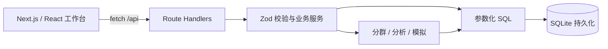

# 实际架构与边界

2026-11-19：根据追加要求，交付改为真实前后端和业务数据接口。

数据库有 projects、people、events、segments、templates、channels、campaigns、journeys、boards、runs、migrations。业务数据带 projectId；事件及业务表有查询索引。

相对初始方案：SQLite 替代 IndexedDB；前端编辑会话使用 React 状态，业务数据通过 API；语义化表格实现服务端分页；Recharts 提供图表，React Flow 提供画布；自定义 CSS Token 提供外观。Zod 在服务端做最终校验。

当前覆盖核心工作台与接口闭环。消息发送和用户响应采用模拟，没有生产账号认证、SDK 采集、供应商凭据或后台自动定时投递。

分群为一级 AND/OR；漏斗为严格顺序、独立用户、2–8 步；邮件为有限区块编辑，未实现任意布局或 HTML 导入。Journey 为本期有向无环图模拟，累计小时处理等待和超时。

Cohorts、Flows、Pivots、CleverAI、预测模型、推荐与高级生命周期优化仍在扩展阶段。

视觉资料见 [官方资料目录](reference-catalog.md)。图片和动画补充图表与预览，视频和手册补充布局与操作；不宣称所有官方页面已完成逐像素还原。

验证见 [验证记录](verification.md)，截图在 screenshots 目录。
