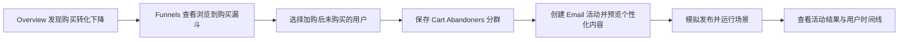
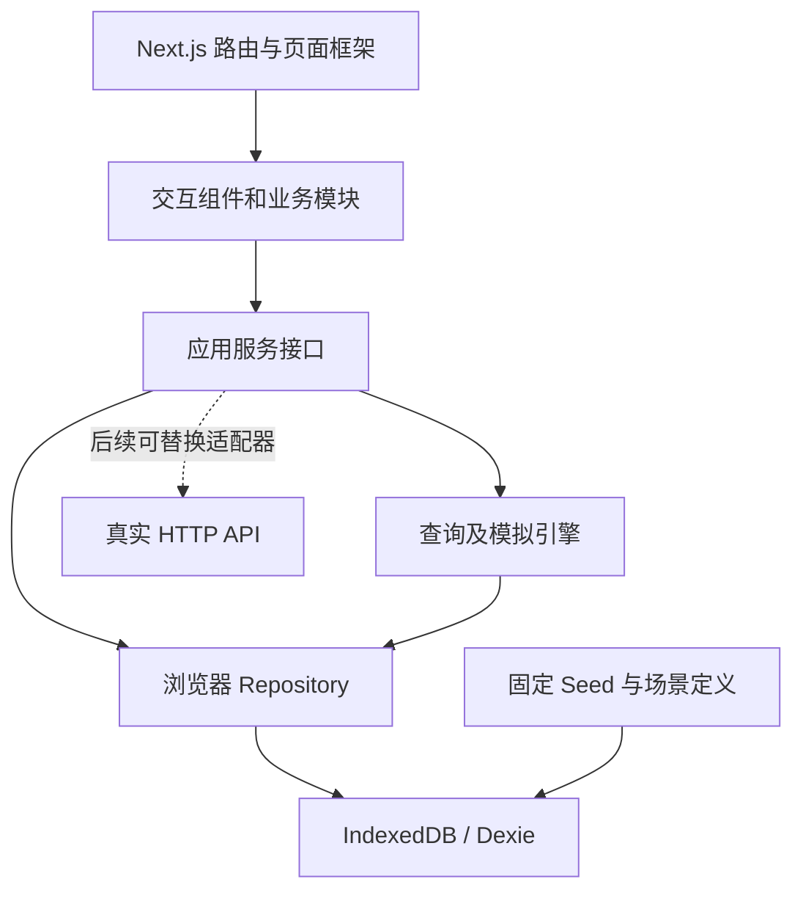

# CleverTap 高保真交互演示版建设方案

执行更新：用户追加真实前后端与数据接口要求。实际已采用 Next.js Route Handlers + SQLite 替代浏览器本地数据层；详见 [实际架构](architecture.md) 与 [API 文档](api.md)。下文保留完整路线规划，不代表所有阶段都已完成。

规划日期：2026-11-19。技术框架：Next.js。项目目录：`clevertap-clone`。

本方案是待实施的建设计划，所列功能与验收均不代表已经开发或测试完成。用户已确认首期交付为“高保真、可交互演示版”。

## 1. 目标与建设原则

交付一个能够连续演示 CleverTap 核心工作流的桌面端产品：查看业务指标，分析用户行为，保存目标分群，创建多渠道活动，编排 Journey，再查看模拟效果。界面布局、控件密度、编辑体验和页面间的联系都需要接近官方产品。

首期最重要的三个结果：

1. 核心页面有明确的官方参考，保持一致的产品外观。
2. 核心按钮产生可观察的结果；配置可保存、刷新后恢复，数据在关联页面中保持一致。
3. 用一套可重复的演示数据讲清完整业务故事，支持重置和重复演示。

### 1.1 当前基础

- 本次检查时项目目录为空，没有可复用的应用、依赖或已有页面。
- 官方 Demo Center 已核对到 5 个主题、18 个专题视频及 1 个平台总览视频。[官方演示中心](https://clevertap.com/demo-center/)
- 已阅读核心产品手册，并抽查 Journey 和 Segmentation 视频画面。尚未完整逐帧拆解全部视频；第一阶段优先拆解 P0 关键片段，其余随专题扩展补充。
- 公开视频、传统产品文档和新版功能文档的界面存在代际差异；目前没有登录态工作台可用于验证所有隐藏状态。

### 1.2 参考依据如何使用

| 资料 | 用途 | 使用规则 |
| --- | --- | --- |
| 官方产品手册 | 确认对象、入口、字段和业务关系 | 是交互规则的主要依据，记录具体页面 URL |
| 官方视频 | 确认布局、操作顺序、弹层与编辑器 | 为关键画面补时间点，不能由单帧推断隐藏行为 |
| 官方功能页面文案 | 理解能力范围与营销场景 | 与手册、实际操作共同确认功能范围 |
| 功能页面的图片、GIF、Lottie 动画 | 还原产品视觉、图表、卡片、节点、内容编辑与预览细节 | 必查视觉资料；渲染动画并记录关键帧，按完整截图、局部界面示意、营销插画分别使用 |
| 本方案的工程设计 | 决定本地演示数据、保存、模拟和验收 | 属于复刻方案约定，不宣称为 CleverTap 内部实现 |

每个模块在开工前选择一套界面基线。视觉资料按界面完整度、清晰度和版本匹配程度选择，功能页的完整产品截图同样可作为主要依据；手册提供字段与行为，视频补足操作过程。局部界面示意和动画用于补充细节，营销插画用于理解业务场景。出现资料版本冲突时，在目录中记录选择。Beta 或 2.0 页面单独标明，不把不同版本控件拼在一起。

本次补充核对发现：Customer Data & Analytics 功能页用 Lottie 展示分析卡片和分群视觉，单独抽取网页文字无法覆盖这些内容。图像采集需要浏览器渲染与目视检查，不能把图像替代文本当作已看过图片。[功能页](https://clevertap.com/customer-data-and-analytics/)

## 2. 首期范围与扩展范围

### 2.1 P0：高保真核心演示版

| 模块 | 首期页面与能力 | 必须形成的交互结果 |
| --- | --- | --- |
| 工作台框架 | 项目切换、侧栏、面包屑、全局日期、帮助入口、当前用户 | 路由可直达，展开状态保留，两个演示项目的数据隔离 |
| Overview / Boards | 指标、趋势、看板列表、看板详情、添加分析卡片、排序与调整布局 | 日期与分群筛选改变支持的卡片；布局、名称、分析配置可保存 |
| Analytics | Trends、事件详情、Funnels | 可选事件、时间、属性、分群；图表与表格联动；结果可加入看板 |
| Segments | 列表、新建、详情、编辑；历史行为与用户属性条件 | 查询人数、样本用户、渠道可达性同步变化；保存后可供活动与旅程选择 |
| Find People / Profiles | 用户搜索、用户列表、用户详情、属性与事件时间线 | 分群样本可进入同一用户详情，时间线来自同一份事件数据 |
| Campaigns | 列表、新建、详情、编辑；Push、Email、In-App、Web Pop-up 四种编辑器 | 创建、预览、保存草稿、复制、模拟发布和效果回看闭环 |
| Templates | 模板列表、筛选、预览、选择、保存为模板 | 选择模板后进入对应编辑器，修改与保存可以重用 |
| Journeys | 列表、画布、新建、编辑、效果详情 | 自定义节点和连线可编辑、校验、保存、模拟运行、查看路径结果 |
| Data / Settings | 事件及属性 Schema、项目时区、四个渠道的演示配置 | 字段字典供条件编辑器复用，时区与渠道状态影响相关页面 |
| 演示工具 | 固定业务场景、场景重置、数据导出 | 重置后回到一致的初始状态；支持的 CSV 导出包含当前筛选结果 |

Boards 的分析卡片、统一筛选等来自官方能力；首期只实现表中列出的子集。[Boards 2.0](https://docs.clevertap.com/docs/boards-v2)

### 2.2 P1：核心版完成后的专题扩展

| 专题 | 建议扩展 | 深度边界 |
| --- | --- | --- |
| 分析补全 | Cohorts 留存热力图、Flows、Pivots | 优先支持固定事件集及有限配置，不建设通用大数据引擎 |
| 实验与优化 | 独立实验列表、Product Experiences、IntelliNODE、Lifecycle Optimizer | 可配置、可保存、可查看预设或模拟结果；不训练优化模型 |
| 预测分群 | Predictive Segmentation 的目标、评分分布及人群展示 | 使用预置评分演示，不训练预测模型 |
| 个性化 | 动态字段、商品目录、推荐结果预览、Reminders | 使用本地商品与规则推荐，明确为演示能力 |
| 渠道补全 | SMS、WhatsApp、RCS、Web Push、App Inbox 等 | 复用活动流程，各渠道拥有自己的编辑与预览组件 |
| CleverAI | Analytics Agent、Segment Builder Agent、Scribe | 先实现示例问法到结构化配置的演示；真实模型接入另定 |
| 数据集成 | 导入任务、连接器目录、接入指引和任务状态 | 小文件可本地解析；外部连接器只展示演示状态 |

P0 活动编辑器包含基础 A/B 双版本与分流配置；P1 再扩展独立实验管理和高级优化专题。

### 2.3 首期执行边界

配置保存、条件计算、图表筛选、模板编辑、画布操作和本地导出需要真实工作。活动发送、用户响应与 Journey 时间推进采用可重复的模拟。

真实 SDK 采集、身份合并、数据仓库、消息供应商、后台定时调度、生产权限、计费及机器学习训练均属于后续工程。顶部提供简洁的 Demo 标识；模拟发布成功提示说明已进入演示状态。

## 3. 信息架构与核心路由

菜单文案以官方英文名称为主，规划文档使用中文。先提供桌面端浅色主题；以 1440×900 为主要验收视口，同时检查 1280×800 与 1920×1080。窄屏保持列表可操作和必要的横向滚动，Journey 暂不承诺完整手机编辑体验。

以下是复刻项目建议的内部路由，不代表官方 URL。P0 共 24 条业务路由模式，包含复用同一编辑器的 new/edit 路由。

```text
/                              → /overview
/overview                      业务总览
/boards                        看板列表
/boards/[boardId]              看板详情
/analytics/trends              趋势分析
/analytics/events/[eventName]   事件详情
/analytics/funnels             漏斗分析
/segments                      分群列表
/segments/new                  新建分群
/segments/[segmentId]          分群详情
/segments/[segmentId]/edit     编辑分群
/people                        查找用户
/people/[personId]             用户详情
/campaigns                     活动列表
/campaigns/new                 新建活动及渠道选择
/campaigns/[campaignId]        活动详情与效果
/campaigns/[campaignId]/edit   编辑活动
/templates                     模板库
/journeys                      旅程列表
/journeys/new                  新建旅程
/journeys/[journeyId]          旅程详情与效果
/journeys/[journeyId]/edit     旅程画布
/data/schema                   事件和属性字典
/settings/project              项目信息、时区和演示重置
/settings/channels             渠道演示配置
```

日期、搜索、筛选和分页等可分享的视图状态写入 URL。表单临时输入、弹层开关、当前选中节点属于页面状态；已保存业务配置属于持久化对象。

## 4. 三条优先打通的演示流程

### 4.1 电商购买转化



关键要求：从漏斗保存的分群携带真实的步骤定义、未完成条件和时间范围。活动使用同一个分群 ID；样本用户与目标人数来自统一计算结果。官方漏斗支持向分群和活动联动，本项目据此选择这条主线。[Funnels 2.0](https://docs.clevertap.com/docs/funnels-v2)

### 4.2 新用户欢迎旅程

用户注册 → 进入 Action 节点 → 发送 Push → 路径等待 1 天 → 判断是否完成首购 → 已购买用户退出，未购买用户发送 Email → 查看目标达成与各节点人数。

画布需要表达渠道动作、等待和超时；模拟时由用户推进演示时钟，不必实际等待一天。上述流程是本项目选择的演示场景。

### 4.3 沉默用户召回

按过去 30 天未活跃及用户属性筛选 → 检查渠道可达性 → 创建两个文案版本 → 检查分流比例 → 预览 In-App 或 Web Pop-up → 模拟结果按版本展示。

四类渠道共用受众和排期能力，编辑器与预览保留各自结构。

## 5. 关键模块的实现规则

本节除引用的官方能力说明外，均为首期演示版的实现约定。开工时将可观察的官方字段逐项映射到页面规格。

### 5.1 分群编辑器与用户详情

官方分群覆盖用户属性、做过或未做过的事件及 AND/OR 条件，是分析与触达之间的共用对象。[Segmentation Rules](https://docs.clevertap.com/docs/segmentation-rules)

- 使用结构化条件树保存配置，不能只保存展示文案。条件具有稳定 ID、字段类型、运算符和值。
- P0 支持属性条件、事件发生/未发生、事件属性、次数、时间窗口、AND/OR 条件组及引用已保存分群。最多两层条件组作为本期简化约定。
- “Calculate”计算总人数、样本和渠道可达人数；修改条件后结果标记为待重新计算。
- 分群详情展示条件摘要、人数趋势、可达性、样本用户及引用它的 Campaign/Journey。
- 编辑已有分群时显示引用关系；删除被引用的分群需要先处理引用，避免活动配置悄悄失效。
- 用户详情以稳定 personId 连接属性、设备和事件记录。官方用户画像将标识、属性和事件关联起来。[User Profiles](https://docs.clevertap.com/docs/user-profiles)

### 5.2 分析与看板

- Trends：选择事件、统计总次数/独立用户数、按日或周聚合、按一个属性拆分，以及日期和分群筛选。
- Funnels：编辑与拖动步骤、选择事件属性、配置转化窗口、展示步骤转化与流失，并可查看样本及保存分群。首期仅实现严格顺序、用户去重的一个计算模式，更多官方模式放入扩展。
- 看板卡片保存分析配置引用，刷新与修改日期后重新计算；支持重命名、移除、拖动和有限尺寸调整。
- 数字、图表、明细和导出共用结果对象，不在各组件里分别造数。
- 无数据、加载中、查询失败及恢复操作均有明确状态。

### 5.3 活动创建与渠道编辑器

保留官方活动创建中的设置、目标受众、内容、发送安排与最终检查的结构；具体名称、折叠方式和字段以选定截图为准。Email 手册提供了渠道选择、目标分群及内容配置的参考。[Create Email Message](https://docs.clevertap.com/docs/create-message-email)

| 渠道 | P0 编辑内容 | P0 预览 |
| --- | --- | --- |
| Push | 标题、正文、图片、跳转、按钮、个性化字段 | iOS / Android 两种外观 |
| Email | 发件信息、主题、预览文本、有限的内容区块、HTML 导入预览 | 桌面 / 手机宽度 |
| In-App | 模板、图片、标题、正文、按钮、关闭行为 | 设备中的弹层位置与样式 |
| Web Pop-up | 模板、内容、触发条件、位置与频次 | 桌面网页容器中的弹窗 |

- Email 首期采用有限区块编辑：新增、删除、排序和编辑文本/图片/按钮；完整任意布局邮件设计器不在 P0。
- 个性化变量从 Schema 字典中选择；缺失字段使用默认值，提供两名不同用户的预览。
- A/B 版本可编辑、复制，比例总和必须为 100%；控制组开关如纳入所选规格，也参与分配校验。
- 排期保存项目时区与标准时间，支持一次性立即模拟或指定时间。重复日历及复杂发送优化放到 P1。
- 草稿可不完整；模拟发布必须通过必填、受众、渠道状态、排期和内容校验，并可定位到对应错误。
- 演示版活动状态约定为 Draft、Scheduled、Running、Paused、Completed，提供允许操作的显式状态表；这些是本项目状态，不承诺覆盖全部官方状态。
- 新发布活动先显示无运行数据；只有运行模拟后才产生结果。预置历史活动可以直接展示固定历史记录。

### 5.4 Journey 编辑器

官方 Journey 由 Segment、Engagement、Controller 节点及连接构成，连接上存在等待时间，渠道还具有不同动作路径。[Journey Concepts](https://docs.clevertap.com/docs/journey-concepts)

首期需要以下结构：

| 类别 | P0 配置或交互 |
| --- | --- |
| Setup 与 Goals | 名称、进入时间、时区、免打扰、控制组、旅程超时、目标事件 |
| Segment 节点 | Action、Inaction、Past Behavior；按节点类型配置条件和时间窗口 |
| Engagement 节点 | Push、Email、In-App、Web Pop-up；复用同渠道内容编辑器 |
| Controller | Force Exit；其他 Controller 放入 P1 |
| 连接 | 按节点和渠道暴露 Yes/No、Sent、Viewed、Clicked、Failed 等适用路径；支持 Sleep Time |
| 编辑体验 | 拖放、连线、选择、复制、删除、缩放、平移、小地图、撤销/重做、自动排版 |
| 保存与模拟 | 保存后保留节点、路径动作、位置、设置和视口；校验后模拟发布；查看模拟轨迹 |

具体渠道有哪些路径以对应手册为准，不能为所有渠道生成相同接口。

- 节点配置使用侧边抽屉；选中节点与连线有明确反馈；缺失配置在节点上标记。
- 校验入口缺失、必要配置缺失、孤立节点、无效连接、重复分支及本期不支持的循环。禁止循环是演示引擎的本期约束，不作为官方通用规则。
- 等待节点需要定义超时路径；官方文档特别说明：设置 qualifying window 后还需连接 Node Timeout，才能使超时用户继续前进。[Define Journey Path](https://docs.clevertap.com/docs/construct-a-journey)
- 使用演示时钟与固定用户脚本模拟路径；同一个用户不能同时计入两个互斥分支。
- 模拟发布保存不可变配置快照，后续结构编辑产生草稿版本；既有模拟记录继续关联原版本。
- Journey 完成规则包含满足目标、Force Exit、无后续路径以及旅程超时，结果人数可追溯。

### 5.5 通用页面状态

列表统一支持搜索、排序、分页、状态筛选和空结果恢复；详情页支持返回来源、复制配置及缺失对象提示。编辑器具有保存中、保存成功、保存失败、未保存离开提示等状态。使用 Toast 反馈短操作，错误与必填问题保留在相关字段附近。

## 6. Next.js 技术架构

### 6.1 技术选型

| 层 | 建议选择 | 选择理由 |
| --- | --- | --- |
| 应用框架 | Next.js 16.x、App Router、TypeScript | 嵌套路由、页面布局、代码分割，便于将来增加服务端能力 |
| React | 与所选 Next.js 版本兼容的 React / React DOM | 使用框架推荐组合，开工时固定依赖与 lockfile |
| 基础样式 | Tailwind CSS、自定义设计 Token | 复刻字体、颜色、边框、密度和栅格 |
| 可访问控件 | Radix / shadcn/ui 作为底层，按官方样式重绘 | 复用弹层、菜单、选择器等行为，外观以参考为准 |
| 表格 | TanStack Table | 共用排序、筛选、分页及列定义 |
| 图表 | Apache ECharts，封装 React 组件 | 趋势、漏斗、热力图及后续分析共用一套图表工具 |
| 旅程画布 | React Flow（`@xyflow/react`）+ 自定义节点/连线 | 复用画布交互，产品规则由业务层实现 |
| 表单 | React Hook Form + Zod | 条件化字段、结构校验和错误定位 |
| 页面状态 | Zustand，限 UI 与编辑会话 | 管理选中项、抽屉和撤销记录，避免复制持久化数据库 |
| 持久化 | Dexie / IndexedDB | 保存配置、演示事件及版本，支持刷新恢复 |
| 验证 | Vitest、Playwright | 检查计算口径和跨页面演示流程 |

本次查阅的 Next.js 官方安装文档标示 16.x，并说明 App Router、TypeScript 等初始化选项；实施时重新核对补丁版本与依赖兼容性后锁定。[Next.js Installation](https://nextjs.org/docs/app/getting-started/installation)

React Flow 提供自定义节点和边等画布基础；Dexie 提供 IndexedDB 与 React 响应式查询，两者适合本项目的画布及本地演示数据需求。[React Flow](https://reactflow.dev/learn)、[Dexie React](https://dexie.org/docs/Tutorial/React)

### 6.2 数据与渲染边界



- 路由、静态框架可保留 Server Components；表格交互、图表、编辑器和本地数据容器在 Client Components 内运行。
- IndexedDB 在客户端挂载后初始化，首次显示确定的加载状态；不在服务端渲染时访问 `window` 或数据库。
- 本地数据模式不通过 Route Handler 读取 IndexedDB。组件依赖应用服务与 Repository 接口，避免未来接入 API 时重写所有页面。
- React Flow、ECharts、复杂渠道编辑器按路由或组件懒加载，不进入所有页面的首屏依赖。
- 查询和模拟逻辑采用纯 TypeScript，必要时放入 Web Worker；不把业务计算写在图表组件或 React effect 中。
- 首期不需要数据库服务器、Redis、消息队列、微服务或真实账号系统。

### 6.3 建议目录

```text
src/
  app/
    (workspace)/
      layout.tsx
      overview/
      boards/
      analytics/
      segments/
      people/
      campaigns/
      templates/
      journeys/
      data/
      settings/
  components/
    shell/                     侧栏、顶栏、项目切换、面包屑
    ui/                        基础控件
    data-table/                列表通用能力
    charts/                    图表外观及交互封装
    query-builder/             属性、事件和条件组编辑器
    channel-editors/           四种渠道的内容编辑与预览
    journey-canvas/            节点、连接、工具栏及配置抽屉
  features/                    各模块页面组合与业务动作
  domain/                      对象类型、规则、状态及校验
  services/                    统一业务接口
  repositories/
    browser/                   Dexie 实现
    contracts/                 Repository 接口
  engines/
    segmentation/              条件树执行
    analytics/                 趋势、漏斗及指标
    simulation/                活动与 Journey 模拟
  demo/
    seed/                      固定数据与版本
    scenarios/                 三条演示流程
  styles/                      Token、全局样式
tests/
  domain/
  e2e/
  visual/
docs/
  reference-catalog.md
  implementation-plan.md
  implementation-backlog.md
```

### 6.4 核心对象与一致性约定

| 对象 | 关键内容 |
| --- | --- |
| Project | ID、名称、时区、演示时钟、Seed 版本 |
| Person / Event | 用户 ID、属性、可达性；事件 ID、时间、属性、所属项目 |
| SchemaDefinition | 字段名称、数据类型、可用运算符、事件属性关系 |
| Segment | 名称、条件树、查询版本、创建及修改时间 |
| Analysis / Board | 分析类型和配置、卡片引用、布局、筛选 |
| Template / Campaign | 渠道内容、受众引用、A/B 版本、排期、状态 |
| Journey / JourneyVersion | 画布、节点配置、连线及动作、目标、发布快照 |
| SimulationRun | 运行 ID、配置快照、随机种子、起始时钟、消息与用户路径记录 |

所有对象带 `projectId`；所有引用使用 ID。统计和样本从同一结果对象产生。运行记录关联配置快照，修改分群或文案不会改写过去运行的结果。

## 7. 演示数据和模拟规则

### 7.1 数据规模与场景

建议初始规模为 1,000 个用户、约 20,000 条事件、12 个分群、12 个活动、4 个 Journey、8 个模板和 3 个看板。它们是工程预算与首期目标，不是已生成的数据。

默认电商项目使用 `App Launched`、`Signed Up`、`Product Viewed`、`Added to Cart`、`Charged` 等统一事件；第二个小型演示项目用于验证切换和隔离。

固定随机种子、Seed 版本和演示时钟。默认锚点为 2026-11-19，项目时区 Asia/Shanghai；“最近 7 天”等筛选相对演示时钟计算，隔天打开仍能复现。支持一键恢复初始数据。

### 7.2 计算口径

- 事件时间存 UTC，按项目时区形成自然日；日期范围内部采用左闭右开区间。
- 用户数按 personId 去重，事件数按 eventId 统计；无事件用户仍可参与“未发生”条件。
- 渠道可达人数按渠道凭据存在且模拟订阅状态允许计算，多个渠道可达人群允许重叠，不能把各渠道人数简单相加当总人数。
- 漏斗首期按用户、严格顺序及配置的转化窗口计算，同一用户在一个漏斗步骤只计一次；流失分群从同一漏斗结果导出。
- A/B 分配使用稳定哈希，固定用户和配置在重复模拟时保持同一版本。
- 模拟消息生成、点击和购买事件带 runId，进入用户时间线；活动报表与 Journey 报表从这些记录汇总。
- 各指标按渠道明确分母。P0 的 Email/Push 点击率以独立成功发送用户为分母，In-App/Web Pop-up 以独立展示用户为分母；转化率以窗口内目标用户 / 对应渠道实际触达用户计算。这些是演示口径，UI 帮助提示中标明。
- 对未定义或超出支持范围的计算显示明确反馈，不用随机数替代计算结果。

## 8. 视觉还原方法

1. 建立图片与动画清单：检查功能页、渠道页、手册中的图片、CSS 背景图、GIF、Lottie 和视频嵌入，记录所属模块和所在版块。
2. 归档参考：为静态图片记录来源页、原图 URL、尺寸、裁剪区域和内容类型；为动画记录来源页、版块、关键帧及帧对应状态。实施时保存到 `docs/reference-assets/`，并与视频时间点、手册截图绑定到具体页面。
3. 标注用途：完整产品截图用于布局与控件；局部界面和动画用于图表、卡片、节点、预览及状态变化；营销插画用于业务场景。每页明确主要依据、补充依据、版本和仍需推断的部分。
4. 提取产品框架 Token：侧栏宽度、顶栏高度、背景、字体、主色、分隔线、控件高度、表格行距和图表风格。数值通过匹配版本的参考画面测量后确定。
5. 用 Overview、Segments 列表、Campaign 编辑器和 Journey 画布四种代表页面校准，再扩展其他页面。shadcn 等组件只复用基础交互，外观按官方基线调整。
6. 图表补齐轴线、刻度、图例、Tooltip、无数据态和钻取反馈，动画中的可见状态变化转化为可操作的产品状态。
7. 保存固定数据、固定视口的本地页面截图，与已归档官方图片或关键帧逐页对照，分别记录布局、排版、控件和状态差异。

视觉验收采用逐项对照表与差异截图，不使用没有测量依据的“还原度 95%”作为承诺。暂时缺少参考的状态要在页面规格中标明为设计推断。

## 9. 实施阶段、依赖和交付物

以下为工作量估算：假设 1 名熟悉 React 的工程师配合 Codex、使用公开资料、不接真实后端，且四个代表页面能及时评审。工程日不是交付承诺；资料缺失、参考变更或扩大编辑器能力会影响估算。

| 阶段 | 工作内容 | 交付与退出条件 | 估算 |
| --- | --- | --- | --- |
| M0 参考基线 | 功能页图片与动画关键帧清单、视频编目、P0 关键片段核对、选定版本、字段和状态表 | 四个代表页面有图像依据及交互参考，范围和关键差异已记录 | 2–3 工程日 |
| M1 产品基础 | Next.js 骨架、设计 Token、Shell、通用列表、Seed、Repository、项目隔离 | 可导航工作台，数据初始化和刷新恢复正常 | 3–4 工程日 |
| M2 数据分析与分群 | Trends、Funnels、Segments、People、Boards、Schema | 完成“漏斗 → 分群 → 用户详情 → 看板”闭环 | 5–7 工程日 |
| M3 活动与模板 | 四渠道编辑器、受众、A/B、排期、草稿、模拟发布与结果 | 同一分群可用于四渠道，活动配置和结果可追溯 | 4–6 工程日 |
| M4 Journey | 自定义画布、路径动作、Sleep/Timeout、版本、模拟器 | 欢迎旅程可编辑、重开、校验、运行并查看路径 | 5–8 工程日 |
| M5 校准与交付 | 三条端到端流程、视觉校准、构建检查、演示指引 | P0 验收通过，提供源码、本地运行方式和演示步骤 | 3–4 工程日 |

P0 合计约 22–32 个有效工程日，按每周 5 个工程日约为 5–7 周。P1 建议作为独立扩展批次，先选专题，再估算；不把全部专题默认塞入首期。

依赖顺序：统一数据与 Schema → 查询条件 → 分析/分群 → 渠道编辑器 → Campaign/Journey → 运行记录与报表。Journey 的节点外观可以提前校准，业务配置和模拟依赖前面的公共能力。

第一个可评审版本在 M1 结束时交付，包含工作台框架、Overview、一个真实可筛选列表和初始演示数据。之后每阶段交付可运行版本。

## 10. 验收与验证方式

### 10.1 必须通过的业务验收

| 场景 | 可观察的通过条件 |
| --- | --- |
| 项目切换 | 项目 A 创建的分群和草稿在项目 B 不出现，切回后仍存在 |
| 查询一致性 | 条件变化后人数、样本、可达性和导出一致；重新计算状态明确 |
| 漏斗联动 | 从流失步骤保存分群后，条件、样本和活动受众能对应 |
| 用户详情 | 从分群和活动进入同一用户，属性和事件记录一致 |
| 配置保存 | 分群、活动、看板和 Journey 保存后刷新，配置与引用完整恢复 |
| 渠道预览 | 修改内容、模板或预览用户，设备预览发生对应变化 |
| 发布校验 | 缺受众、无内容、无可用渠道、比例错误等问题阻止模拟发布并定位错误 |
| 新活动结果 | 发布后不凭空出现历史统计，运行模拟后出现可追溯记录 |
| 画布恢复 | 节点、位置、分支、等待、超时和内容刷新后一致 |
| 路径正确 | 固定样本用户按预期通过互斥分支，人数可以由运行记录核对 |
| 版本隔离 | 编辑已发布 Journey 产生新草稿，旧运行继续使用原快照 |
| 重置与复现 | 重置到相同 Seed 和时钟后，演示流程及计算结果可重复 |

### 10.2 验证投入

- 领域测试重点覆盖 AND/OR、未发生事件、日期边界、漏斗去重、稳定分流、Journey 等待/超时及运行快照；使用有人工期望值的小样本。
- Playwright 覆盖三条核心业务流程、深链接刷新和项目隔离；画布至少覆盖拖放、连线、配置和恢复。
- 固定数据与视口校准关键页面截图；演示发布与运行结果单独截图留证。
- 运行 TypeScript、ESLint、生产构建，并在生产模式检查深链接和首次初始化。
- 控制台没有未处理异常；主要列表、编辑器和画布具备加载、空结果及失败恢复。
- 首期参考性能目标：在指定本地验收设备、20,000 条事件下，常用查询完成于 1 秒内，画布约 50 个节点可平移缩放。实施时记录设备和实际结果；超出预算再引入 Worker 或索引优化。

## 11. 主要风险与处理

| 风险 | 应对 |
| --- | --- |
| 公开资料分属不同版本 | M0 冻结模块参考；后续升级按模块处理 |
| Journey 只完成外观 | 将节点校验、路径模拟和保存恢复列为退出条件 |
| 统计为各页独立假数 | 建立统一事件、查询结果和运行日志，禁止页面自行随机造数 |
| Email 设计器扩大范围 | P0 固定区块编辑与预览，完整任意布局单列扩展 |
| IndexedDB 升级与演示失效 | 数据库版本迁移、Seed 版本、可恢复初始化及重置入口 |
| 海量事件阻塞交互 | 限定数据规模，先计时，再按需索引或移入 Worker |

## 12. 后续真实能力接入方向

完成演示版后，可以保持页面与业务服务接口，逐步把浏览器 Repository 替换为真实 API。先接一个数据源与一个渠道，验证身份、订阅、可达性和回执，再扩展渠道和执行引擎。

届时需要另外设计租户与认证、权限、事件采集、服务端存储、异步执行、幂等、频控、退订、供应商回调及审计。Next.js 可以继续承载工作台与 BFF；持续调度和消息执行应由独立后台任务承担。该阶段不计入当前 P0 排期。

## 13. 待实施时收敛的非阻塞项

- 演示版名称与品牌素材：默认项目名 CleverTap Clone，首期英文界面。
- 核心界面基线：默认当前手册优先，M0 逐页记录实际选择。
- 部署位置：先提供本地运行；对外预览环境在需要交付链接时选择。
- P1 专题先后：核心闭环完成后，根据演示目的挑选，不影响 P0 开始。

详细资料见 [官方资料目录](reference-catalog.md)，实施顺序见 [任务清单](implementation-backlog.md)。
